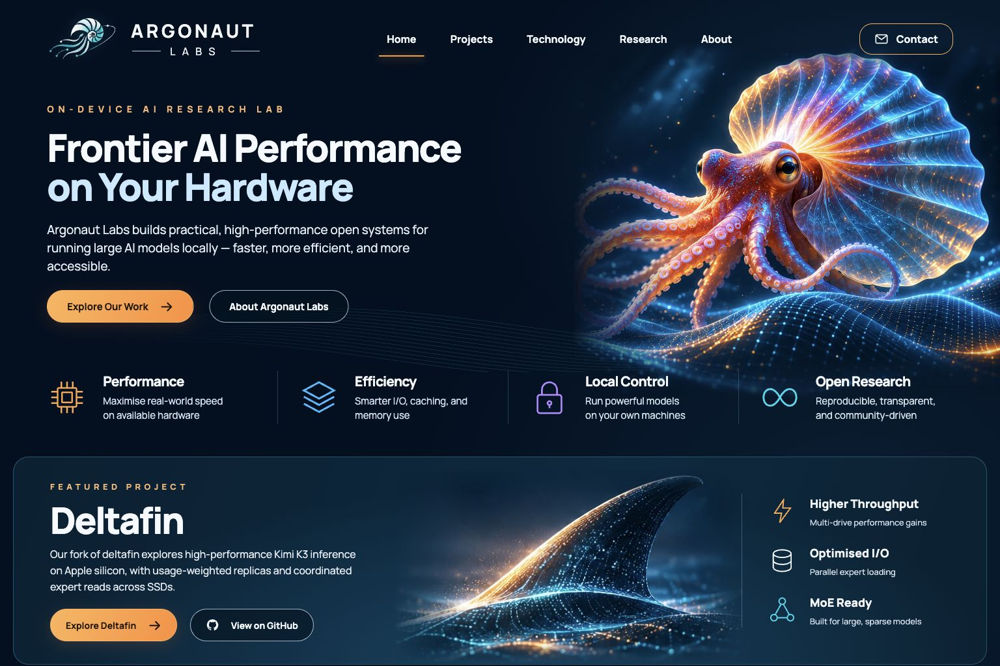
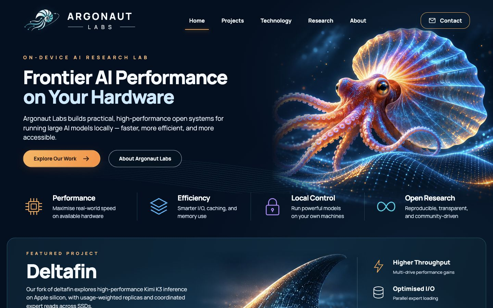
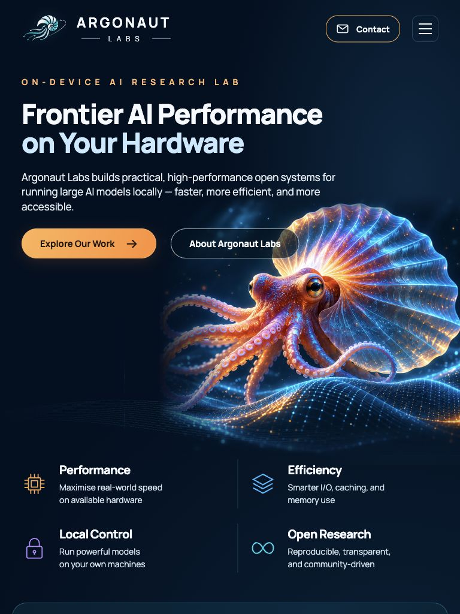
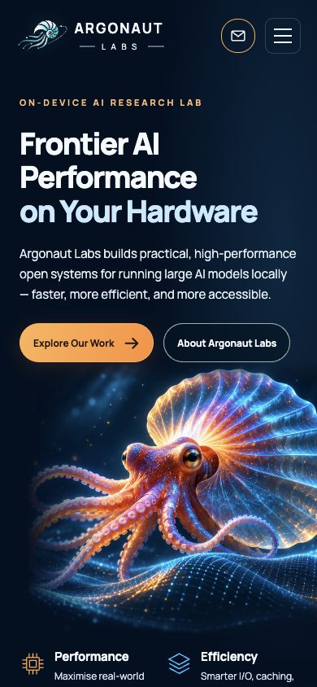

# Cinematic homepage redesign — review

Implements the supplied, approved Argonaut Labs homepage mockup in the existing GitHub Pages site. The user approved publication after review; merging into `main` publishes through the existing Pages configuration.

## Changes

- Midnight navy homepage, the original shell/tentacle/orbit brand, luminous argonaut hero, amber calls to action, horizontal desktop navigation and a keyboard-friendly mobile menu.
- Four value pillars and a Deltafin feature panel using the supplied illustrations, compressed to WebP. The hero now uses the cleaner 1448 × 1086 source supplied after review (346,764-byte WebP from a 2,615,628-byte PNG). New text and controls are real HTML.
- The complete existing research, measured results, hardware photograph, engine diagram, Argodrive section, credits and footer remain below the new opening. Their homepage presentation follows the new palette.
- Homepage-only CSS and JavaScript live in `assets/cinematic/`. The Manrope font is self-hosted with its OFL license. New runtime assets total 498,424 bytes; no framework, tracking service or runtime CDN was added.

## Preservation and validation

Based on `d33a9e5b563e2cc013845c1a79752d8e227b7275`, including the two Kimi benchmark updates that arrived during implementation.

- SHA-256 comparison: all 34 existing files other than `index.html` are unchanged. This includes every research page, dataset, shared stylesheet, existing illustration and diagram script, `CNAME`, `.nojekyll`, `robots.txt`, `sitemap.xml` and `llms.txt`.
- All six existing homepage tables, original headings/paragraphs/captions/cells, old anchor IDs, link destinations and inline benchmark JavaScript are retained. The former Kimi opening section follows the new hero; the public `#overview` anchor remains the homepage opening.
- All 51 checked local file destinations returned HTTP 200, including research routes, data downloads and linked assets. Unknown paths return 404.
- All 34 unique external link destinations returned HTTP 200. Hacker News required GET rather than HEAD.
- Desktop and mobile navigation, Escape-to-close, focus handoff, model tabs, measured-series availability, and the engine diagram's mode/pause controls were exercised in the browser.
- No horizontal overflow at the four review sizes. No page-origin console errors observed. Browser-extension warnings were excluded.
- Primary CTA contrast is at least 7.76:1 across the gradient. Visible focus styles and reduced-motion styles are included; this is not a full accessibility certification.
- New navigation and retained inline JavaScript pass syntax checks. HTML local anchors/assets, JSON-LD and CSS asset references resolve. There is no application build pipeline to run.
- Added source was checked for local home-directory paths, common credential patterns and conversation-export markers; none found. Screenshots contain the webpage only. Development backups remain outside the public repository.

The current Kimi table stays explicit: the 3.11 tok/s result is a 512-token raw completion with the optional Qwen drafter; the standard pp512/tg128 arm is separate. Prefill is 44 tok/s at 1,512 prompt tokens. The design introduces no new performance measurements or changes to benchmark caveats.

Machine-readable check summary: [validation.json](validation.json).

## Intentional visual adaptations

- Uses the provided original-brand vector rather than turning the illustrated hero creature into the logo.
- Uses dark text on amber buttons for contrast instead of the mockup's white button text.
- The full-resolution hero is blended into the background with CSS masks; the fin mask removes edge text remnants from its supplied crop. Mobile artwork and feature content reflow instead of shrinking a screenshot.
- Keeps the existing research pages' own presentation and public URLs intact. The new style is scoped to the homepage.

## Previews

### Desktop — 1536 × 1024

### Desktop — 1440 × 900

### Tablet — 768 × 1024

### Mobile — 390 × 844

## Review and publish

Review the screenshots and diff, then merge the feature branch into `main` to publish. No Pages settings, domain configuration or secrets need changing. The original homepage is recoverable from the base commit above. Do not merge without design review.

For a local preview, run `python3 -m http.server 8080 --bind 127.0.0.1` from the repository and open `http://127.0.0.1:8080/`.
